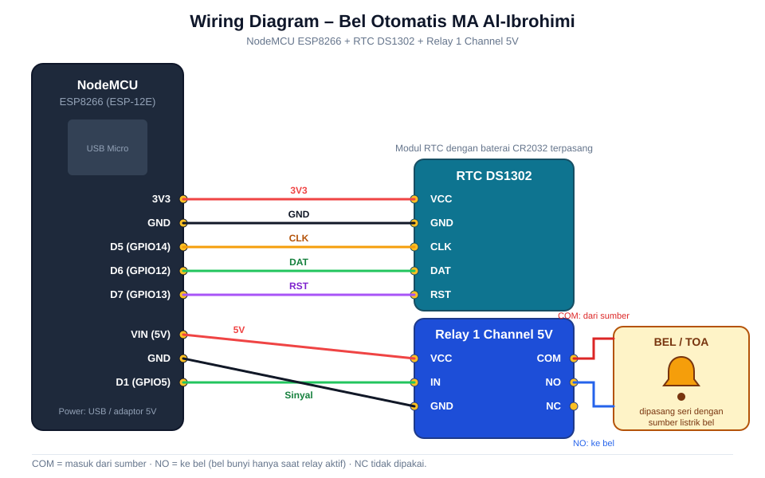

# 🔔 Bel Otomatis – MA Al-Ibrohimi Manyar Gresik

Sistem bel sekolah otomatis berbasis **NodeMCU ESP8266**. Jadwal bel diatur lewat halaman web dari HP atau laptop, tanpa internet. ESP8266 membuat WiFi sendiri (Access Point), dan waktu disimpan di modul **RTC DS1302** supaya jadwal tetap jalan walaupun listrik padam.

## ✨ Fitur

- Web dashboard yang disajikan langsung dari ESP8266 (LittleFS), terbuka otomatis lewat captive portal
- Jadwal bel otomatis, maksimal **50 jadwal**, dengan pilihan hari aktif dan durasi bel (1–30 detik)
- Template jadwal cepat: **KBM**, **ASAT**, dan **MA**
- Bel manual: tahan tombol untuk membunyikan bel, lepas untuk menghentikan
- Waktu RTC otomatis disinkronkan dari perangkat (HP/laptop) saat halaman dibuka
- Jadwal tersimpan permanen di flash (`jadwal.json`)
- REST API JSON sederhana

## 🧰 Komponen

| No | Komponen | Jumlah | Keterangan |
|----|----------|--------|------------|
| 1 | NodeMCU ESP8266 (ESP-12E) | 1 | Mikrokontroler + WiFi |
| 2 | RTC DS1302 + baterai CR2032 | 1 | Penyimpan waktu |
| 3 | Modul relay 1 channel 5V | 1 | Menyambung/memutus bel |
| 4 | Bel listrik atau amplifier TOA | 1 | Beban yang dikendalikan relay |
| 5 | Adaptor 5V 1A (atau kabel USB) | 1 | Catu daya NodeMCU |
| 6 | Kabel jumper + kabel listrik | secukupnya | |

## 🔌 Wiring



### Tabel koneksi

| NodeMCU | Perangkat | Pin perangkat |
|---------|-----------|---------------|
| 3V3 | RTC DS1302 | VCC |
| GND | RTC DS1302 | GND |
| D5 (GPIO14) | RTC DS1302 | CLK |
| D6 (GPIO12) | RTC DS1302 | DAT |
| D7 (GPIO13) | RTC DS1302 | RST |
| VIN (5V) | Relay | VCC |
| GND | Relay | GND |
| D1 (GPIO5) | Relay | IN |

Sisi beban pada relay:

| Terminal relay | Sambungan |
|----------------|-----------|
| COM | Kabel dari sumber listrik bel |
| NO | Kabel ke bel / amplifier |
| NC | Tidak dipakai |

> ⚠️ **Peringatan keselamatan:** jika bel memakai listrik **220V AC**, matikan MCB/cabut stopkontak sebelum menyambung kabel ke relay, dan pastikan sambungan terisolasi rapi. Jika ragu, minta bantuan teknisi listrik.

## 📁 Struktur Repository

```
bel-otomatis/
├── belotomatis/
│   ├── belotomatis.ino      # Program ESP8266
│   └── data/                # Diupload ke LittleFS
│       ├── index.html
│       ├── app.js
│       ├── style.css
│       └── logo.png
├── docs/
│   └── wiring-diagram.svg
└── README.md
```

Nama folder sketch harus sama dengan nama file `.ino` (aturan Arduino IDE). Folder `data/` harus berada di dalam folder sketch.

## 🛠️ Langkah Pemasangan

### 1. Rakit perangkat keras

1. Sambungkan **RTC DS1302** ke NodeMCU sesuai tabel di atas (pastikan baterai CR2032 terpasang).
2. Sambungkan **relay** ke NodeMCU (VIN, GND, D1).
3. Sambungkan beban bel ke terminal **COM** dan **NO** relay, secara seri dengan sumber listrik bel.
4. Pastikan semua **GND tersambung bersama**.
5. Jangan nyalakan listrik 220V dulu sampai pengujian di langkah 5 selesai.

### 2. Siapkan Arduino IDE

1. Install [Arduino IDE](https://www.arduino.cc/en/software) (disarankan 2.x).
2. Buka **File → Preferences**, lalu isi *Additional Boards Manager URLs*:
   ```
   http://arduino.esp8266.com/stable/package_esp8266com_index.json
   ```
3. Buka **Tools → Board → Boards Manager**, cari **esp8266**, lalu install.
4. Pilih board **NodeMCU 1.0 (ESP-12E Module)**.
5. Install library lewat **Library Manager**:

   | Library | Versi |
   |---------|-------|
   | ArduinoJson (Benoit Blanchon) | 7.x |
   | Rtc by Makuna | 2.x |

   `ESP8266WiFi`, `ESP8266WebServer`, `DNSServer`, dan `LittleFS` sudah termasuk di paket board ESP8266.

6. Pasang plugin upload LittleFS:
   - Arduino IDE 1.8.x: [arduino-esp8266littlefs-plugin](https://github.com/earlephilhower/arduino-esp8266littlefs-plugin)
   - Arduino IDE 2.x: [arduino-littlefs-upload](https://github.com/earlephilhower/arduino-littlefs-upload) (jalankan lewat `Ctrl+Shift+P` → *Upload LittleFS to Pico/ESP8266*)

### 3. Upload program

1. Buka `belotomatis/belotomatis.ino`.
2. Pada **Tools**, atur:
   - Board: `NodeMCU 1.0 (ESP-12E Module)`
   - Upload Speed: `115200`
   - Flash Size: `4MB (FS:2MB OTA:~1019KB)` atau `4MB (FS:1MB ...)`
   - Port: sesuai port NodeMCU
3. Klik **Upload** untuk mengunggah sketch.

### 4. Upload file web (LittleFS)

1. Pastikan folder `data/` berisi `index.html`, `app.js`, `style.css`, dan `logo.png`.
2. **Tutup Serial Monitor**, lalu jalankan *LittleFS Data Upload*.
3. Tunggu sampai muncul pesan upload selesai.

> Langkah 3 dan 4 sama-sama wajib. Jika langkah 4 terlewat, halaman web akan menampilkan pesan "LittleFS belum di-upload!".

### 5. Uji coba

1. Buka **Serial Monitor** (115200 baud). Akan muncul:
   ```
   [FS] LittleFS OK
   [RTC] DS1302 OK
   [WiFi] AP: Bel-MA  IP: 192.168.1.1
   === SIAP ===
   ```
2. Dari HP, sambungkan ke WiFi:
   - **SSID:** `Bel-MA`
   - **Password:** `987654321`
3. Buka browser dan akses **http://192.168.1.1** (biasanya halaman terbuka otomatis lewat captive portal).
4. Pastikan jam di dashboard tampil dan benar. Waktu RTC otomatis disinkronkan dari perangkat Anda.
5. Tahan tombol **BEL MANUAL**. Relay harus berbunyi "klik" dan LED relay menyala. Lepas tombol, relay mati.
6. Jika relay sudah bekerja normal, baru sambungkan ke bel/listrik 220V.

### 6. Atur jadwal

1. Pilih **Template Cepat** (KBM / ASAT / MA), atau tambah jadwal manual: pilih jam, isi nama, pilih durasi, pilih hari aktif, lalu tekan **+ TAMBAH JADWAL**.
2. Jadwal akan muncul di **Jadwal Aktif** dan tersimpan permanen.

## ⚙️ Konfigurasi

Ubah di bagian atas `belotomatis.ino`:

```cpp
#define RELAY_PIN     D1
#define RTC_CLK       D5
#define RTC_DAT       D6
#define RTC_RST       D7

const char* AP_SSID     = "Bel-MA";
const char* AP_PASSWORD = "987654321";   // ganti dengan password Anda
```

**Level aktif relay.** Pada kode, relay aktif saat pin **HIGH** (`RELAY_ACTIVE HIGH`). Banyak modul relay bersifat *active LOW*. Jika relay Anda menyala terus saat standby atau terbalik, tukar nilainya:

```cpp
#define RELAY_ACTIVE    LOW
#define RELAY_INACTIVE  HIGH
```

## 🌐 REST API

| Method | Endpoint | Fungsi |
|--------|----------|--------|
| GET | `/api/status` | Waktu, IP, jumlah jadwal, status relay |
| GET | `/api/jadwal` | Daftar jadwal |
| POST | `/api/jadwal` | Tambah jadwal |
| POST | `/api/jadwal/delete` | Hapus jadwal (`{"id": n}`) |
| POST | `/api/jadwal/toggle` | Aktif/nonaktifkan jadwal |
| POST | `/api/jadwal/template` | Terapkan template (`KBM`, `ASAT`, `MA`) |
| POST | `/api/jadwal/reset` | Hapus semua jadwal |
| POST | `/api/manual` | Bunyikan bel (`{"durasi": detik}`) |
| POST | `/api/stop` | Hentikan bel |
| POST | `/api/settime` | Set waktu RTC |

## 🩺 Troubleshooting

| Masalah | Penyebab / solusi |
|---------|-------------------|
| Halaman menampilkan "LittleFS belum di-upload" | Jalankan *LittleFS Data Upload* (langkah 4) |
| Jam menunjukkan 00:00 atau waktu salah | Cek kabel RTC dan baterai CR2032; buka halaman web dari HP agar waktu tersinkron |
| Relay terbalik (menyala saat standby) | Tukar `RELAY_ACTIVE` dan `RELAY_INACTIVE` |
| Tidak bisa upload | Pilih port yang benar, tutup Serial Monitor, coba kabel USB data (bukan kabel charge saja) |
| Tidak bisa membuka WiFi `Bel-MA` | Pastikan NodeMCU menyala dan sudah muncul pesan `=== SIAP ===` di Serial Monitor |
| Halaman tidak terbuka otomatis | Buka manual `http://192.168.1.1` |

## 📜 Lisensi

Dibuat untuk MA Al-Ibrohimi Manyar Gresik. Tambahkan file `LICENSE` sesuai kebutuhan (misalnya MIT).

---

2026 © MA Al-Ibrohimi · Created by Kusuma
